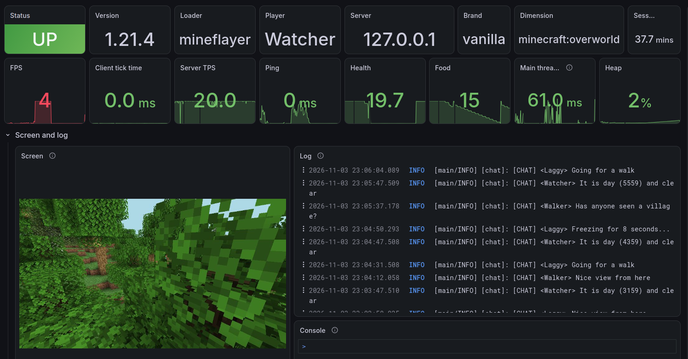

<h1 align="center" style="font-weight: normal;"><b>mineflayer-prometheus</b></h1>
<p align="center">A Prometheus exporter for mineflayer bots.</p>
<p align="center"><a href="https://github.com/headlesshq/hmc-prometheus">hmc-prometheus</a> | <a href="https://github.com/PrismarineJS/mineflayer">mineflayer</a> | <a href="https://github.com/PrismarineJS/prismarine-viewer">prismarine-viewer</a></p>



A [Prometheus](https://prometheus.io) exporter for [mineflayer](https://github.com/PrismarineJS/mineflayer) bots,
supporting the metrics of [hmc-prometheus](https://github.com/headlesshq/hmc-prometheus).
Allows you to create Grafana dashboard that show mineflayer bots and real Minecraft clients side by side.
It exports FPS, server TPS, ping, players, position, health, ... together with runtime metrics,
can push the log of the bot (chat with colors, kicks, errors) to [Loki](https://grafana.com/oss/loki/),
and can render what the bot sees with [prismarine-viewer](https://github.com/PrismarineJS/prismarine-viewer).
See [example](example) for a Prometheus, Loki and Grafana setup with the dashboards, and demo bots.

## Setup

```shell
npm install @headlesshq/mineflayer-prometheus
```

```js
const mineflayer = require('mineflayer')
const { prometheus } = require('@headlesshq/mineflayer-prometheus')

const bot = mineflayer.createBot({ host: 'localhost', username: 'bot-1' })
bot.loadPlugin(prometheus({ lokiUrl: 'http://127.0.0.1:3100' }))
```

The bot serves its metrics on `http://127.0.0.1:9400/metrics` (or the next free port) and writes a
discovery file to `~/.hmc-prometheus/targets`, the same directory as hmc-prometheus, so the
Prometheus of the [example](example) finds bots and clients without any configuration.

### Rendering

Rendering is optional, because it needs native modules. Install the renderer next to the plugin:

```shell
npm install prismarine-viewer@1.33.0 three@0.128.0 node-canvas-webgl@0.3.0 canvas@3.2.3
```

`node-canvas-webgl` depends on old versions of `gl` and `canvas` that don't build on current systems,
so override them in your `package.json` and install again:

```json
"overrides": {
  "gl": "8.1.6",
  "canvas": "3.2.3"
}
```

## Configuration

Options are passed to `prometheus(options)`. Every option can also be set with an environment variable,
e.g. `MINEFLAYER_PROMETHEUS_LOKI_URL=http://127.0.0.1:3100`, which overrides the option in code,
which is useful when you start many bots from scripts.

| Option                 | Default                     | Description                                                                           |
|------------------------|-----------------------------|---------------------------------------------------------------------------------------|
| `enabled`              | `true`                      | Start the exporter with the bot.                                                      |
| `client`               | username                    | Value of the `client` label, identifies this bot in Grafana.                          |
| `host`                 | `127.0.0.1`                 | Address to bind to. Use `0.0.0.0` if Prometheus runs on another machine.              |
| `port`                 | `9400`                      | First port to try.                                                                    |
| `portRange`            | `100`                       | How many following ports to try, if the port is in use.                               |
| `include`              | (all)                       | Metrics to export, by name, group or last part.                                       |
| `exclude`              | `['jvm']`                   | Metrics not to export. The `jvm` group is covered by the `jvm_*` metrics.             |
| `jvmMetrics`           | `true`                      | Export the runtime metrics of Node.js as `jvm_*` and `process_*`, see below.          |
| `collectTimeoutMs`     | `2000`                      | How long a scrape waits for the main thread.                                          |
| `discoveryDir`         | `~/.hmc-prometheus/targets` | Directory for the Prometheus discovery files, empty to disable.                       |
| `discoveryAddress`     | `host`                      | Address written to the discovery file, e.g. `host.docker.internal`.                   |
| `grafanaUrl`           | `http://localhost:3000`     | Used by `bot.prometheus.status()` to print a link to the dashboard of this bot.       |
| `lokiUrl`              | (disabled)                  | Base URL of Loki to push the log to, e.g. `http://127.0.0.1:3100`.                    |
| `captureConsole`       | `false`                     | Also push everything written with `console.*` to Loki.                                |
| `render`               | `false`                     | Render with prismarine-viewer, serve screenshots on `/screenshot.png` and `/live`.    |
| `screenshotIntervalMs` | `1000`                      | Minimum time between two screenshots on `/screenshot.png`.                            |
| `liveFps`              | `10`                        | Frames per second of `/live`, a JPEG stream.                                          |
| `renderWidth`          | `854`                       | Width of the screenshots.                                                             |
| `renderHeight`         | `480`                       | Height of the screenshots.                                                            |
| `viewDistance`         | `6`                         | View distance of the renderer in chunks.                                              |
| `renderWaitMs`         | `5000`                      | How long a screenshot waits for chunks that are still being meshed.                   |
| `console`              | `false`                     | Allow executing commands from the web console on `/console`.                          |
| `stopOnEnd`            | `true`                      | Stop the exporter when the bot disconnects, so that a reconnecting bot can take over. |
| `commands`             | `{}`                        | Commands for the web console, `{ name: (args, bot) => output }`.                      |
